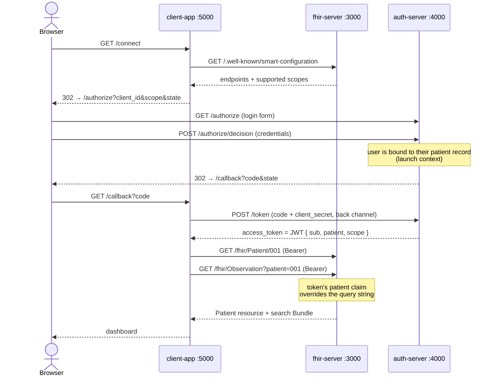

<h1 align="center">🏥 SMART on FHIR POC</h1>

<p align="center">
  A miniature healthcare ecosystem: a FHIR API server (EHR stand-in), an OAuth 2.0
  authorization server, and a patient-facing app — implementing the
  <strong>SMART on FHIR standalone launch flow</strong> end-to-end in TypeScript,
  with no health-tech libraries.
</p>

<p align="center">
  <a href="#quick-start">Quick start</a> ·
  <a href="#docker">Docker</a> ·
  <a href="#how-the-flow-works">How it works</a> ·
  <a href="#security-model">Security model</a>
</p>

<p align="center">
  
  
  
  
  
</p>

---

## Features

- FHIR resources (`Patient`, `Observation`), search `Bundle`s, and `OperationOutcome` errors
- OAuth 2.0 **Authorization Code flow** with SMART clinical scopes (`patient/Patient.read`, …)
- Discovery via `/.well-known/smart-configuration` — the app learns everything from the server
- **Launch context**: the token is bound to one patient — cross-patient requests get `403`
- One-time authorization codes (60 s TTL), scope enforcement, `redirect_uri` validation
- Two-layer enforcement on every FHIR call: *scope check* → *patient-context check*
- SQLite storage (JSON resource documents + search indexes), Pug templates, Docker compose stack

## How the flow works



The FHIR server and the auth server never talk to each other — they are decoupled by
design: the FHIR server only validates the JWT signature locally. Same trust model as a
real hospital EHR.

## Services

| Service | Port | Role |
|---|---|---|
| `packages/fhir-server` | 3000 | Hospital EHR: discovery doc, `Patient`/`Observation` endpoints, SQLite storage |
| `packages/auth-server` | 4000 | OAuth 2.0 authorization server: login, code minting, token exchange |
| `packages/client-app` | 5000 | Third-party app: discovery, auth flow, FHIR dashboard (Pug views) |
| `adminer` | 8080 | DB browser for the SQLite data (Docker only) |

Each package follows the same layered layout — `routes → controllers → services`,
with `middleware` for auth and `views` for templates.

```
packages/<app>/
├── server.ts          # bootstrap: express, view engine, routers, listen
├── config.ts          # ports, secrets, env overrides
├── routes/            # Router wiring only
├── controllers/       # request handlers (HTTP concerns)
├── services/          # business logic (clients, users, codes, tokens, FHIR calls)
├── middleware/        # (fhir-server) Bearer auth + scope checks
└── views/*.pug        # HTML templates
```

## Quick start

```bash
pnpm install

# all 3 services, color-prefixed logs, Ctrl+C stops everything:
pnpm dev
```

Open **http://localhost:5000** → *Connect to hospital* → sign in:

| user | password | patient |
|---|---|---|
| `bacha` | `pass1` | 001 (Bacha Khan) |
| `umar` | `pass2` | 002 (Umar Hassan) |

Prefer separate terminals?

```bash
npx tsx packages/fhir-server/server.ts
npx tsx packages/auth-server/server.ts
npx tsx packages/client-app/server.ts
```

## Docker

```bash
docker compose up --build
```

| URL | What |
|---|---|
| http://localhost:5000 | the full app flow |
| http://localhost:8080 | Adminer — browse the SQLite data |

Adminer login: System **SQLite** · any username · password **`poc-viewer`** · DB **`/data/fhir.db`**
(the DB lives on a shared Docker volume; server-to-server traffic uses compose service names,
browser-facing URLs stay on `localhost`).

## Security model

Every `/fhir` request passes two gates, and the data layer is scoped on top:

| Attack | Defense | Result |
|---|---|---|
| Replay an authorization code | codes are single-use, 60 s TTL | `400 invalid_grant` |
| Read another patient's chart | `patient` claim in the JWT is checked against the requested id (and silently overrides `?patient=`) | `403` |
| Forge a token | JWT signature — FHIR server verifies with the shared secret | `401 invalid token` |
| Use a scope the app wasn't granted | scope enforced per endpoint via middleware | `403` |
| Point the callback elsewhere | `redirect_uri` must match the registered value exactly | `400 Bad redirect_uri` |
| Log in as someone else at the token endpoint | client secret required on the back channel | `401 invalid_client` |

### Attack scenarios

All of these are reproducible against a running stack:

1. Replay the `?code=` from the callback URL → `invalid_grant`
2. Sign in as `bacha`, then call `/fhir/Patient/002` with her token → `403 Token is scoped to another patient`
3. Request only `patient/Patient.read`, then load observations → `403` missing scope
4. Change the `redirect_uri` query param on `/authorize` → `400`
5. Mint a JWT with a wrong secret and call `/fhir/Patient/001` → `401`

## Known limitations

- **Shared symmetric JWT secret** — production systems use asymmetric keys + a JWKS URL
- **No PKCE** — mandatory for public/native apps today
- **`state` is generated but never verified** — open TODO
- **SQLite with seed data** — no migrations, no concurrency story
- **No HTTPS, no refresh tokens**, secrets hardcoded, error pages leak token responses

## Roadmap

- PKCE (`S256`) for public clients + `state` verification
- EHR launch (launch context from the EHR instead of a standalone login)
- Refresh tokens + token lifetimes
- Asymmetric signing with a JWKS endpoint
- Integration against the public sandbox: [launch.smarthealthit.org](https://launch.smarthealthit.org)
